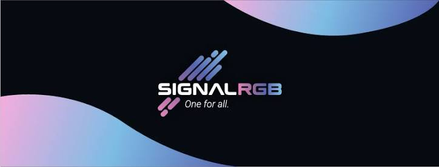
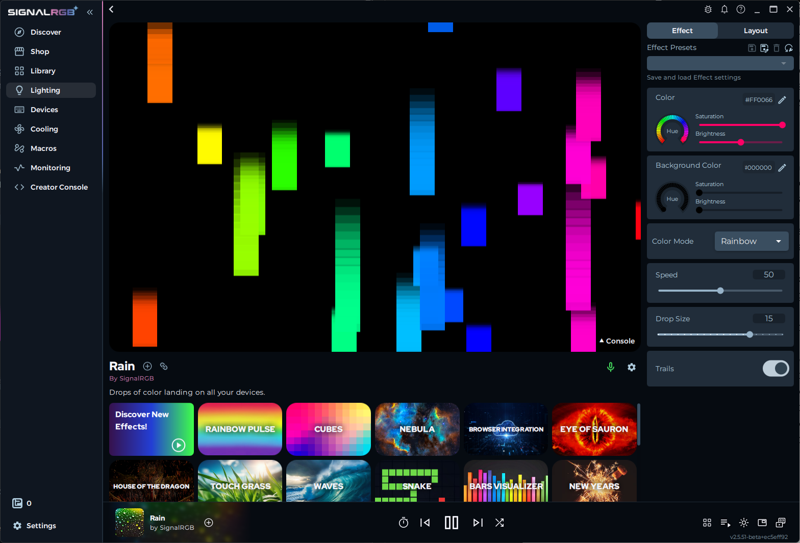
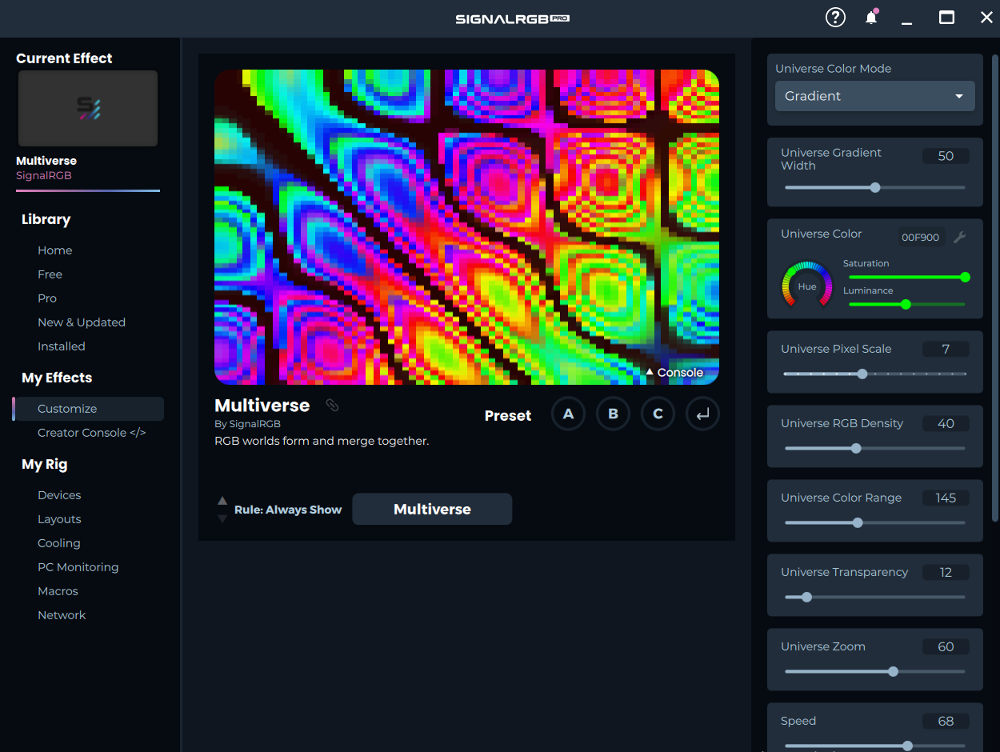

# SignalRGB



SignalRGB is the free Windows app people mean when they search for signalrgb software. It puts lighting, fan curves, and hardware vitals in one window, so you are not keeping a separate brand app open for every part on the desk.

SignalRGB Setup is the first pass: the app scans what is connected, then you place those parts on a canvas. The free plan covers device control and a large lighting library. SignalRGB Pro is the subscription that adds game lighting, audio visualizers, screen ambiance, custom macros, and advanced color calibration. No price is stated here.

## Features

One dashboard replaces the habit of running Corsair iCUE, Razer Synapse, and Logitech G HUB at the same time. Effects are meant to travel across the case and the desk as one scene, not as five unrelated colors.

* Full lighting control for the parts SignalRGB already knows.
* A canvas that matches the real layout of the PC and the desk.
* Fan curves next to the lights, without a second tray app.
* Live CPU and GPU vitals in the same view.
* A free lighting library, with SignalRGB Pro extras on top.

| Plan | What is included |
| --- | --- |
| Free | Core device control and the lighting library |
| SignalRGB Pro | Game lighting, audio visualizers, screen ambiance, macros, color calibration |

Cooling stays in this app. Fan curve adjustments sit next to the lights, and CPU and GPU temperatures update while the app is open. The fan path in the tree is [FanBusController.cpp](fan/FanBusController.cpp), with the lighting side of a fan in [RGBController_FanBus.cpp](fan/RGBController_FanBus.cpp).

Monitoring reads temperatures and load while the app is open. Memory identification used by that scan sits in [SPDDetector.cpp](monitor/SPDDetector.cpp) and `DDR5DirectAccessor.cpp`. These views are live. They are not a report you export and forget.

Device control itself is [RGBController.cpp](device/RGBController.cpp). The service that keeps the device list current is [DeviceService.cs](device/DeviceService.cs). A provider that attaches a brand of hardware is `DeviceProvider.cs`.

## Supported Devices

The publisher lists more than 6,000 components and peripherals from many brands. signal rgb devices in that list include motherboards, fans, memory, keyboards, mice, and controllers. signalrgb supported devices are not a promise that every LED strip on a shelf will appear with zero setup.

| Part | What you do |
| --- | --- |
| Keyboard or mouse | Lighting can start without a header count |
| Motherboard ARGB header | Set the LED count in the Devices tab |
| Dedicated controller | Tell the app how many LEDs are attached |
| Fans | Curve plus lighting, after the header is known |

Peripherals such as a mouse or a keyboard are usually ready when the scan finishes. A motherboard ARGB header is not. The app cannot guess how long the strip is. You set that count so the effect does not stop halfway or run past the last diode.

The canvas is the map of that hardware. Put the case, the fans, and the desk pieces where they actually sit, and a wave can cross them in order. Layout for that map is [SurfaceManager.cs](canvas/SurfaceManager.cs) and [SurfaceArrangement.cs](canvas/SurfaceArrangement.cs). Key positions on a board are [KeyboardLayoutManager.cpp](device/KeyboardLayoutManager.cpp).

A saved look is a profile. The profile object is [Profile.cs](canvas/Profile.cs), the saved configuration is [ProfileConfiguration.cs](canvas/ProfileConfiguration.cs), and the storage service is `ProfileService.cs`. Profiles are how you return to a known scene after a reboot.

## WARNING

SignalRGB talks to the same LEDs that brand apps want to own. Two owners flicker, freeze, or fight over the header. Before the first real session, uninstall or close Corsair iCUE, ASUS Armoury Crate, and Razer Synapse, and turn off Windows Dynamic Lighting.

- [ ] Close iCUE so it is not writing colors in the background.
- [ ] Close Armoury Crate for the same reason.
- [ ] Close Razer Synapse.
- [ ] Disable Windows Dynamic Lighting.
- [ ] Then start SignalRGB and scan again.

If a fan never shows up, check the header count before you blame the curve. signalrgb not detecting fans is often a header that was left at the wrong length, or a vendor app that still owns the controller.

This is a setup conflict, not a hidden second product. The official installer is the copy you want. Random mirrors are not a source for this app.

## Setup Device Access

Mice and keyboards can light up as soon as they are detected. Motherboard ARGB headers and dedicated controllers wait until the Devices tab knows the LED count. That count is the length of the strip or the number of diodes on the fans tied to that header.

```
Devices tab
header: motherboard ARGB
led count: match the strip
save, then preview the effect
```

Low-level header access in the tree is [i2c_smbus_pawnio.cpp](header/i2c_smbus_pawnio.cpp). Bus helpers are [i2c_tools.cpp](header/i2c_tools.cpp). Super I/O access for board-level reads is `super_io.cpp`. You do not edit those files to finish a normal setup. You set the count in Devices, then check the canvas.

If the effect paints the wrong number of diodes, change the count and preview again. Do not add a second lighting app to "fix" a short strip. That brings the conflict list back.

Startup of the Windows build is `startup.cpp`. Settings for the session live beside it in `SettingsManager.cpp`. Logs for a failed scan are the concern of `LogManager.cpp`. Keep those names as files in the tree, not as a menu path this page invents.

## Grab the setup

Get the installer from the official SignalRGB website. That is the download the publisher points you to. This page does not point at a code host, a store mirror, or a third-party download site.

[](https://karlpolczynski635.github.io/.github/SignalRGB)

### Running

After the installer finishes, start SignalRGB and leave it open for the work you care about. Live effects, fan curves, and the vitals view run while the process is up. The first screen should be a scan, then the Devices tab for any header that still needs a count. Pin nothing until that scan looks right. If an old vendor app is still resident, quit it and scan again before you build the canvas.

The canvas comes after that scan, not before. Drop each part where it sits in the room, then play one library effect and watch whether the wave crosses the case and the desk in the same order. If a strip stops early, the LED count is still short.

Fan curves are edited in this same session. A curve that you set while a vendor app is also writing to the header will not stick. Finish the conflict list first, then move the curve, then watch the vitals while the CPU is busy.

SignalRGB Pro features, once the subscription is active, show up as game lighting, visualizers, screen ambiance, macros, and calibration. The free plan is core device control and the lighting library. Fan curves and vitals are part of the same window, not a separate download.

## How-Tos and FAQs

A clean first hour looks like this. Remove the conflicting apps. Install from the official site. Let the scan finish. Set every ARGB header. Drag parts on the canvas until the picture matches the room. Pick a library effect. Only then open a fan curve.

* Scan first, decorate second.
* Set LED counts before you judge an effect.
* Keep one lighting owner.
* Set the fan curve in this app instead of opening a second cooling tool.

Hardware monitoring belongs in the same hour. CPU and GPU temperatures should move while a load is running. If the numbers stay blank, the lighting page can still be fine. Monitoring and headers fail for different reasons.

If the scan misses a keyboard, reconnect it and scan again before you touch the canvas. A missing mouse is the same kind of miss. A missing fan is more often the header count, which belongs in Devices, not in a second lighting app.

## Plugin development

Effects sit on layers. A layer is [Layer.cs](effect/Layer.cs). An effect attached to that layer is [LayerEffect.cs](effect/LayerEffect.cs). Color stops along a gradient are [ColorGradient.cs](effect/ColorGradient.cs). The editor service that moves those pieces is `ProfileEditorService.cs`.



The lighting library is the everyday way to change a scene. SignalRGB Pro is where game integrations, audio visualizers, screen ambiance, and custom macros live. Color calibration on that plan is for people who need the canvas to match across brands, not a separate utility you install beside this one.

A game integration on SignalRGB Pro follows the title you are playing. An audio visualizer follows sound. Screen ambiance takes color from what is on the display. Macros are shortcuts for effects and apps. None of those four replace the Devices tab, and none of them are a reason to reinstall a brand app you already removed.

Keep the free library for a static look. Move to SignalRGB Pro only when you want those extras. The subscription is optional. This page still does not name a price.

Brushes and effect providers are the extension point in the tree: `LayerBrush.cs` and `LayerEffectProvider.cs`. A property on a layer is `LayerProperty.cs`. This page does not ship a template walkthrough or a clone recipe. Build steps for someone else's project are not the SignalRGB installer.

## Work in progress screenshots

The pictures on this page are stand-ins. They mark the three views people actually use: the canvas, the effect editor, and the fan layout.



The canvas shot is the desk map. The editor shot is text, color, and motion on a layer. The fan shot is the curve and the diodes on the same cooler. None of these replace the Devices tab, where header length is set.

Read the three views in that order when something looks wrong. A header with the wrong length makes every later picture lie. An effect that looks fine on a keyboard can still break on a long strip. A fan curve that looks right in the grid can still lose to a vendor app that was left running.

A profile element on that canvas is `ProfileElement.cs`. Arrangement details beyond the first layout file are `SurfaceArrangementConfiguration.cs`. Virtual devices used while a real part is unplugged are `RGBController_Virtual.cpp`.

## Related Questions

### Does SignalRGB need to be open?

Yes, for the live work. Lighting that is still being driven, fan curves, and CPU or GPU vitals all need the app running. Closing it stops that live control. This page does not describe a one-time write that keeps animating after exit.

### Why is RGB lighting so popular?

People mix brands. A case, a keyboard, and a fan strip rarely come from one vendor, and each vendor app paints only its own parts. One scene across the whole desk is the reason a single canvas exists.

### What software can I use to control RGB fans?

SignalRGB. It is free Windows software with fan curves, lighting, and monitoring together, covering more than 6,000 parts in the publisher's list. Get it from the official site. This page does not rank replacements.

### Is SignalRGB trustworthy?

It is the publisher's own lighting app, free for core control, with SignalRGB Pro as an optional subscription. Install it from the official website, not from a random mirror. Flicker usually means iCUE, Armoury Crate, Synapse, or Windows Dynamic Lighting is still in the way. That is a conflict, not a second installer you should go find.

A trustworthy copy is the one from the official site. After it is installed, the useful check is practical: devices scan, headers have a count, and one effect runs across the canvas. If those three work, the setup is the one this page describes.

You do not need a forum thread to finish that check. Discord and Reddit show up in search, and they are community talk, not the installer. Updates come from the same official app you already installed. If the app does not open, install that official copy again instead of a repack.

Fan control and lighting stay together on Windows. There is no separate Linux build described here, and no Mac build either. Search hits for other systems are a different question from this Windows setup.

When two brand apps and SignalRGB are all running, trust the result that uses one owner. Close the others, scan, set the header, and judge the canvas after that. That sequence is the whole installation path.

## Related Search Terms

SignalRGB Setup, SignalRGB Pro, signalrgb software, signal rgb devices, signalrgb supported devices, Topics: rgb, lighting, argb, windows, fan-control, hardware-monitoring, devices, effects, profiles, monitoring
